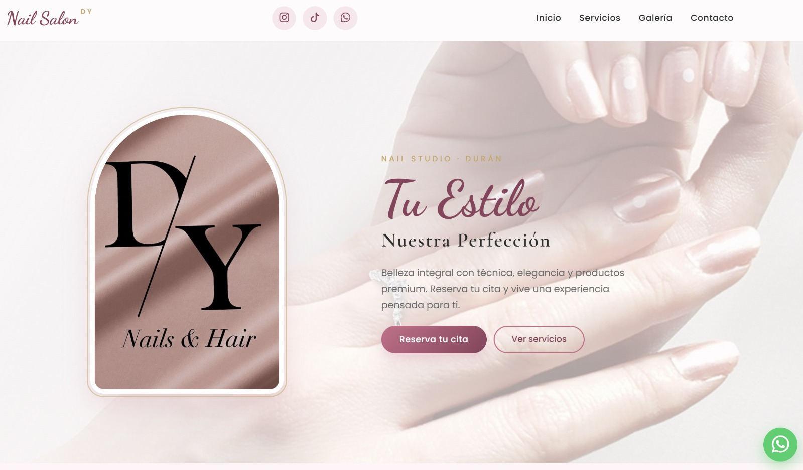

# 👨‍💻 Jonathan Yumisaca — Portafolio Personal

**Estudiante de Ingeniería en Software · Atleta CrossFit**

Sitio web personal de enlaces y portafolio de proyectos desarrollados.

---

## 🚀 Demo en vivo

👉 **[Ver sitio publicado](https://jonathanyc02.github.io/Mi_página_web/)**

---

## 📸 Vista previa

---

## ✨ Características

- 🎨 Diseño **moderno** con efecto *glassmorphism* (cristal esmerilado)
- 🌙 Interfaz **oscura** con acentos en púrpura
- 📱 Totalmente **responsive** (móvil, tablet y escritorio)
- 🔗 Enlaces directos a redes sociales (Instagram, YouTube, TikTok, Facebook)
- 💼 Sección de **proyectos** con tarjetas, descripciones y tecnologías usadas
- ⚡ Animaciones suaves con transiciones CSS
- 🖼️ Miniaturas de proyectos clickeables
- 📅 Año automático en el footer con JavaScript

---

## 🛠️ Tecnologías utilizadas

| Tecnología | Uso |
|---|---|
| **HTML5** | Estructura semántica del sitio |
| **CSS3** | Estilos, animaciones, grid y flexbox |
| **JavaScript** | Año dinámico en el footer |
| **Google Fonts** | Tipografía *Roboto Mono* |
| **GitHub Pages** | Hosting gratuito |

---

## 📂 Estructura del proyecto
